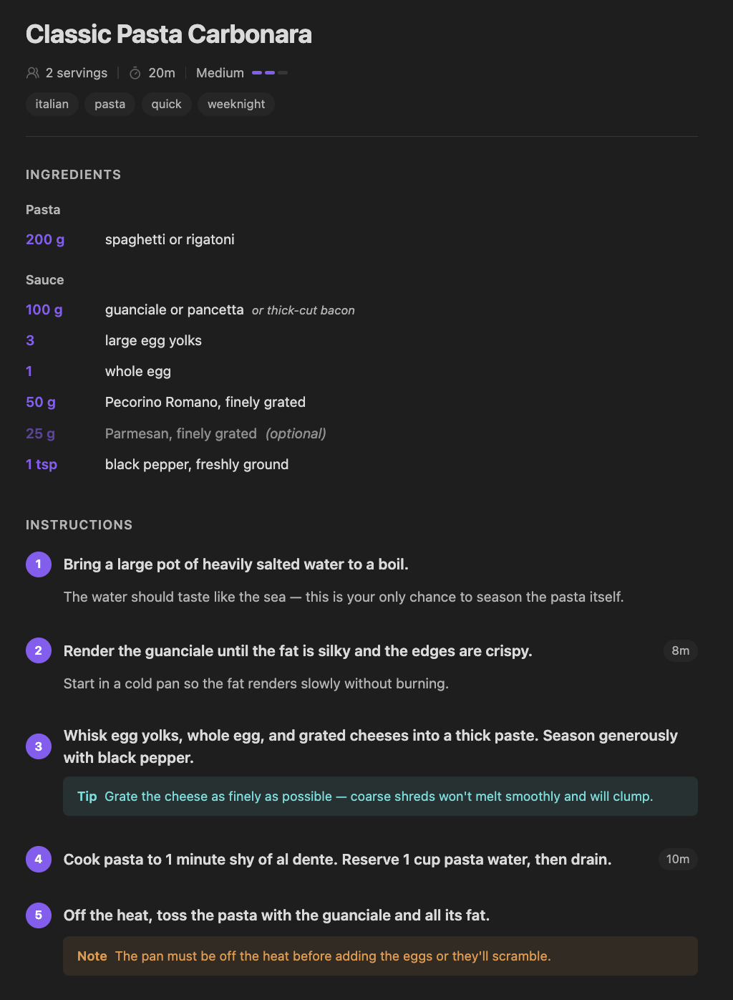
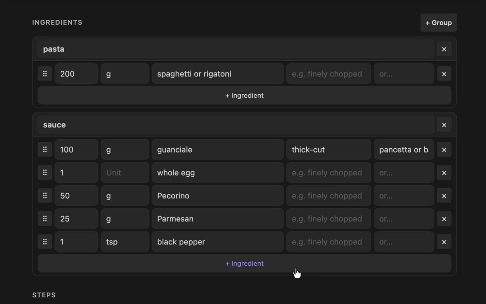
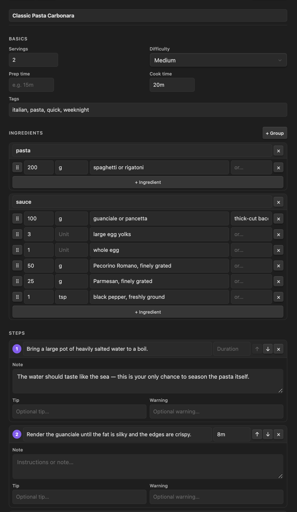

<p align="center"></p>

<h1 align="center">Kaper for Obsidian</h1>

<p align="center"><b>Recipes that live in your vault.</b></p>

<p align="center">Structured recipes inside plain markdown notes. Inline preview. Form editor. Step-by-step Cook Mode. Works on desktop and mobile.</p>

<p align="center"><a href="https://obsidian.md/plugins?id=kaper">Install</a>&nbsp;· <a href="docs/kaper-format.md">File format</a>&nbsp;· <a href="https://kaper.me">Kaper web app</a>&nbsp;· <a href="https://github.com/nikoneex/obsidian-kaper/issues">Issues</a>&nbsp;· <a href="CHANGELOG.md">Changelog</a></p>

<p align="center"></p>

[Kaper](https://kaper.me) is a local-first recipe manager: plain markdown files, no cloud, no account. This plugin brings it into Obsidian. A note with a ` ```kaper ` block becomes a real recipe, rendered right where the block sits, with the rest of your note around it.

## What you can do

- **Write recipes as notes.** A recipe is a markdown file with `kaper: true` in its frontmatter and a ` ```kaper ` YAML block in the body. Everything outside the block is normal markdown. For example, a story about where the recipe came from, links to related notes, or photos.
- **See them rendered inline.** In Live Preview and Reading view, the block becomes a formatted recipe card with ingredients, steps, times, tags, and images. Switch to Source mode to see the raw YAML.
- **Edit with a form instead of YAML.** Set the title, servings, prep and cook time, tags, ingredient groups, and steps with notes, tips, warnings, and durations. Drag ingredients to reorder them. Every change saves automatically.
- **Cook step by step.** Click **Start Cooking** to walk through the recipe one step at a time, with a progress bar and ← / → keys. It opens as a dockable side panel on desktop and a full-screen sheet on mobile.
- **Match your theme.** Kaper uses your accent color and surface palette, so recipes look at home in any theme.

Kaper works on desktop and mobile. On mobile, recipes are a read-only preview and Cook Mode. Creating, converting, and form editing are desktop-only for now.

<p align="center"></p>

## Get started

1. In Obsidian, open **Settings → Community plugins**, search for **Kaper**, then install and enable it.
2. Click the utensils icon in the left ribbon, or run **Kaper: Create recipe** from the command palette. To turn a note you already have into a recipe, open it and run **Kaper: Convert current note to recipe**.
3. Fill in the recipe in the **Form** tab, then switch to **Preview** to see it rendered. Click **Start Cooking** when you're ready to cook.

If you use the Kaper web or desktop app too, set **Settings → Kaper → Kaper vault root folder** to the folder you open there. Kaper stores step images under `_assets/` in that folder, so both sides need to agree on where it is. Leave it empty to use the vault root. That's the only setting.

## Commands

| Command                                   | What it does                                                             |
| ----------------------------------------- | ------------------------------------------------------------------------ |
| **Kaper: Create recipe**                  | Creates a new recipe note with a starter block. Desktop only.            |
| **Kaper: Convert current note to recipe** | Adds the frontmatter and a starter block to the open note. Desktop only. |

## File format

A recipe needs two markers: `kaper: true` in the frontmatter, and a fenced ` ```kaper ` YAML block. The required keys are `title`, `servings`, `ingredients`, and `steps`. Everything else is optional.

````markdown
---
kaper: true
---

A true Roman classic. No cream, no shortcuts.

```kaper
title: Classic Pasta Carbonara
servings: 2
difficulty: medium
time:
  cook: 20m
tags: [italian, pasta, weeknight]
ingredients:
  pasta:
    - amount: 200
      unit: g
      name: spaghetti
  sauce:
    - amount: 100
      unit: g
      name: guanciale
      note: diced
      sub: pancetta
steps:
  - title: Bring a large pot of salted water to a boil.
    note: The water should taste like the sea.
  - title: Cook guanciale in a cold skillet until crispy.
    duration: 8m
version: 1
```

Tips and notes go here as regular markdown.
````

Recipes created by the plugin get a stable id (`kaper: r_<id>`), so a file keeps its identity when you rename or move it. Older `kaper: true` files keep working and get an id the first time you open them. See [the format reference](docs/kaper-format.md) for every key.

## Works with the rest of Kaper

The same `.md` file opens in this plugin, in the Kaper web app at [kaper.me](https://kaper.me), and in the Kaper desktop app (in development). There's no sync layer to set up. Your files move through whatever you already use: iCloud, Dropbox, Syncthing, git, or a USB stick.

Prefer the browser? **View on Kaper** on any recipe opens the full web app.

## Privacy and network use

Kaper runs entirely inside Obsidian. There is no Kaper server and no account, so we can't read your files.

- **No network requests of its own.** Rendering, editing, and Cook Mode all happen locally.
- **View on Kaper** opens `kaper.me?from=obsidian` in your browser. The only thing it sends is that `from` parameter. Your recipe is not uploaded.
- **Remote images are your choice.** If you point a `coverImage` or step `image` at an `http(s)` URL, Obsidian loads it from that host when the recipe renders. That request goes to a server we have no connection to. To keep everything local, use vault paths or the form's image upload.

## Quality

Every change runs through [TypeScript](https://www.typescriptlang.org/), [ESLint](https://eslint.org/) with the official [Obsidian ESLint plugin](https://github.com/obsidianmd/eslint-plugin), [Prettier](https://prettier.io/), [Vitest](https://vitest.dev/), and a production build in [CI](https://github.com/nikoneex/obsidian-kaper/actions/workflows/ci.yml).

Recipes render as [CodeMirror 6](https://codemirror.net/) block widgets inside Obsidian's own editor, the same pipeline that draws headings and embeds. There's no second UI layered over the editor. YAML goes through Obsidian's built-in `parseYaml` / `stringifyYaml`, and ingredient drag-and-drop uses [dnd-kit](https://dndkit.com/), which supports keyboard, touch, and mouse.

## Manual installation

1. Download `main.js`, `manifest.json`, and `styles.css` from the [latest release](https://github.com/nikoneex/obsidian-kaper/releases/latest).
2. Put them in your vault's `.obsidian/plugins/kaper/` folder.
3. Open **Settings → Community plugins** and enable **Kaper**.

## Help and feedback

- Report bugs and request features in [Issues](https://github.com/nikoneex/obsidian-kaper/issues).
- See what changed in each version in the [changelog](CHANGELOG.md).

## Contributing

Bug fixes and pre-discussed features are welcome. Kaper is a one-person, spare-time project, so a few rules keep it stable:

- **Open an issue first.** Discuss any new feature, architecture change, or big refactor before writing code. PRs that weren't discussed get closed.
- **No AI-generated bulk.** Large AI-generated PRs aren't accepted. Keep code readable, minimal, and in the style that's already here.
- **Pass the checks.** Run `npm run format`, `npm run lint`, `npm run build`, and `npm test` before you push.
- **Keep it small.** One PR, one issue.

To work on the plugin locally:

```bash
git clone https://github.com/nikoneex/obsidian-kaper.git
cd obsidian-kaper
npm install
npm run dev
```

Then symlink the repo into a test vault's `.obsidian/plugins/kaper` folder.

## License

[MIT](LICENSE)

---

<p align="center"><b>Want the full Kaper experience?</b> Open any folder of recipes at <a href="https://kaper.me">kaper.me</a>. No install. No signup.</p>
